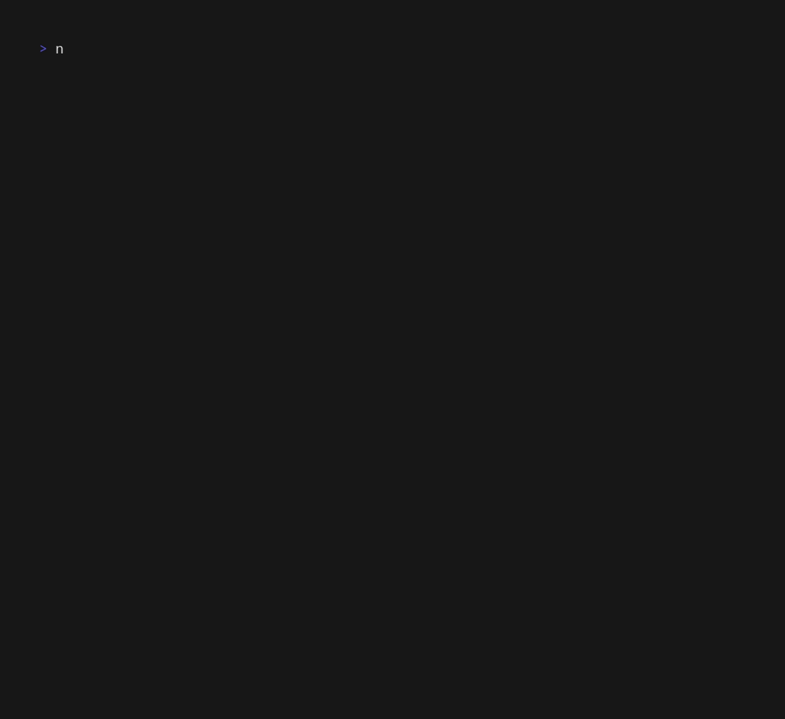

# ASCII-Everything

A collection of ASCII art projects and terminal tools — the single hub for all of it.

## Projects

### 3D Cube — [`3DCube/`](3DCube/)


### Image to ASCII — [`ImageToAscii/`](ImageToAscii/)

Convert images to colored ASCII art in the terminal (regular and true-color modes).


```bash
pip install -r ImageToAscii/requirements.txt
python ImageToAscii/image_to_ascii.py path/to/image.png
```

See [`ImageToAscii/README.md`](ImageToAscii/README.md) for all options.

### Mermaid CLI — [`mermaidcli/`](mermaidcli/)

Render Mermaid diagrams as ASCII art in the terminal (state and sequence diagrams; flowcharts experimental).





```bash
node mermaidcli/src/cli/index.js diagram.mmd
```

See [`mermaidcli/README.md`](mermaidcli/README.md) for architecture and options.

### Abstract JS — [`abstract JS/`](abstract%20JS/)

Terminal ambient visuals and experiments in JavaScript: fluid, ambient light, chaos, cubes, and waves.

## History

`ImageToAscii` and `mermaidCLI` started as standalone repositories. They were
linked here as git submodules, then merged into this repo outright on
2026-10-20 — full commit history preserved — so ASCII-Everything is
self-contained.
