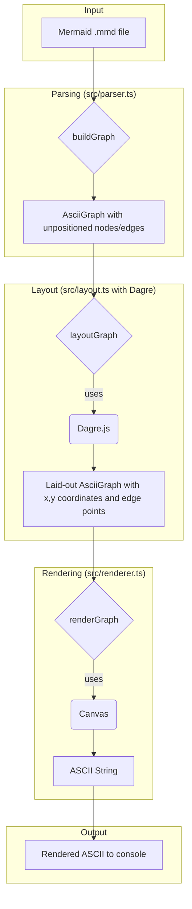

# Plan to Fix the Mermaid ASCII CLI Rendering Engine

The current rendering engine for the Mermaid ASCII CLI tool has issues with correctly displaying graph connections. This plan outlines the steps to replace the placeholder layout and rendering logic with a more robust solution using the `dagre` library.

## 1. Integrate `dagre` for Graph Layout

*   **Add Dependencies:** Add `dagre` and its TypeScript type definitions (`@types/dagre`) to the project's `package.json`.
*   **Update Layout Logic:** Rewrite the `layoutGraph` function in `src/layout.ts` to use `dagre`.
    1.  Create a new `dagre.graphlib.Graph` instance.
    2.  Set the graph options (e.g., `rankdir: 'TB'`).
    3.  Iterate through the `AsciiGraph` nodes and add them to the `dagre` graph using `g.setNode()`.
    4.  Iterate through the `AsciiGraph` edges and add them to the `dagre` graph using `g.setEdge()`.
    5.  Run the `dagre.layout()` function on the graph.
    6.  Update the `AsciiNode` positions (`x`, `y`) and `AsciiEdge` paths (`points`) with the values calculated by `dagre`.

## 2. Enhance the Rendering Engine

*   **Improve Edge Drawing:** Rewrite the `drawEdge` function in `src/renderer.ts` to draw the paths provided by `dagre`. This will involve iterating through the `points` of an `AsciiEdge` and drawing lines between them.
*   **Refine Node Drawing:** Improve the `drawNode` function in `src/renderer.ts` to draw better-looking rhombus shapes using `/` and `\` characters.

## 3. Update Data Structures

*   **Modify Types:** Update the `AsciiEdge` type in `src/types.ts` to include an optional `points` property, which will be an array of `{ x: number; y: number }` objects.

## New Architecture

Here is a Mermaid diagram that illustrates the proposed new architecture:

